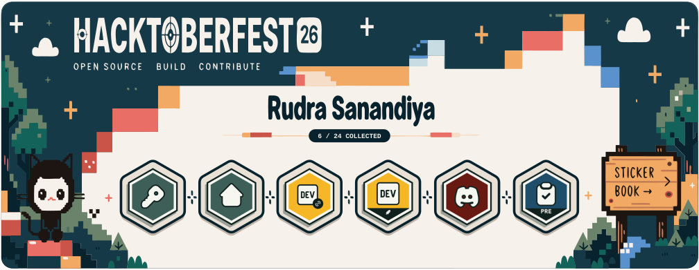

# Hacktoberfest 2026 Sticker Showcase

<!-- HACKTOBERFEST:START -->
<p align="center">
  <a href="https://rudra1806.github.io/hacktoberfest-2026/" title="Open the full Hacktoberfest 2026 sticker book">
    
  </a>
</p>
<!-- HACKTOBERFEST:END -->

A banner of the Hacktoberfest 2026 stickers I've earned, for my GitHub profile, plus a
[sticker book](https://rudra1806.github.io/hacktoberfest-2026/) with every sticker and certificate.
Both are generated from [`data/hacktoberfest.json`](data/hacktoberfest.json).

## Add a newly earned sticker

1. Download the sticker's certificate from Hacktoberfest and save it in
   `assets/hacktoberfest/certificates/`, e.g. `pr1-cert.png`.
2. In `data/hacktoberfest.json`, update (or add) the sticker entry:
   ```json
   "earned": true,
   "featured": true,
   "earnedDate": "2026-10-12",
   "image": "assets/hacktoberfest/stickers/pr1.png",
   "certificate": "assets/hacktoberfest/certificates/pr1-cert.png"
   ```
   The `image` file doesn't need to exist: it is cut out of the certificate automatically.
3. Commit and push. The **Hacktoberfest Sticker Update** workflow regenerates the banner,
   the sticker book and this README. To preview locally first, run `npm run generate`.

The banner has six slots. With more than six stickers, it shows the first five plus a
"+N more" slot; the sticker book always lists everything.

## Commands

| Command | What it does |
| --- | --- |
| `npm run generate` | Cut out missing sticker images, rebuild the banner, sticker book and README |
| `npm run check` | Exit 1 if any generated file is out of date |
| `npm run extract` | Re-cut every earned sticker from its certificate |
| `npm run validate` | Validate the manifest and that its files exist |

`assets/hacktoberfest/branding/banner-template.svg` is the banner artwork. To use a new export
from Recraft, run `node scripts/prepare-banner-template.mjs <exported.svg>`.
